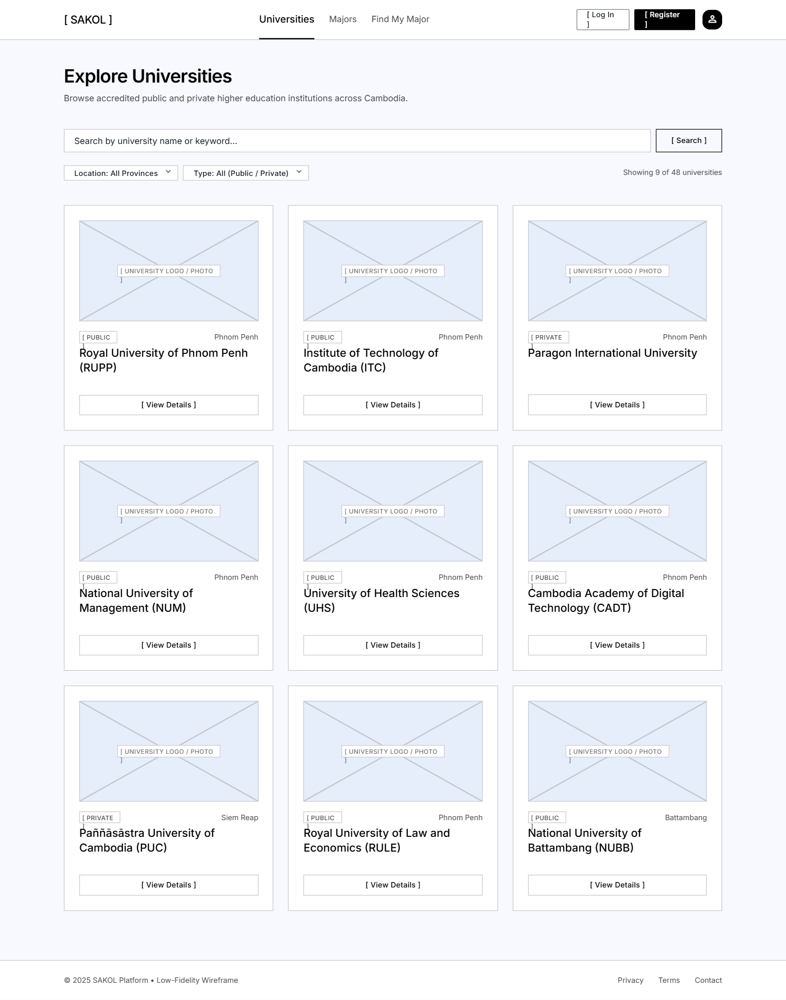
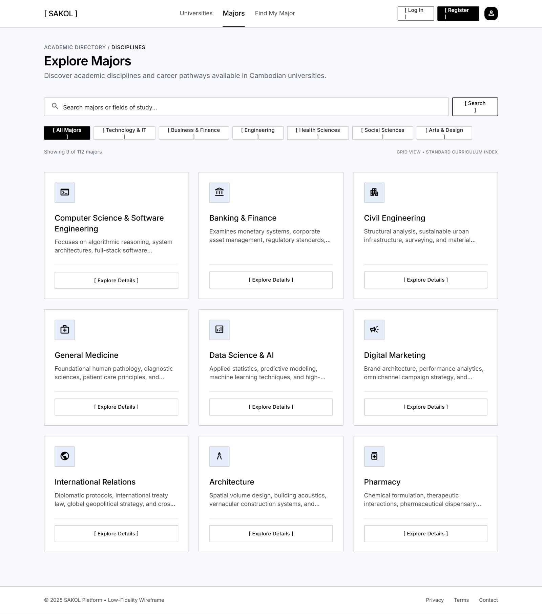
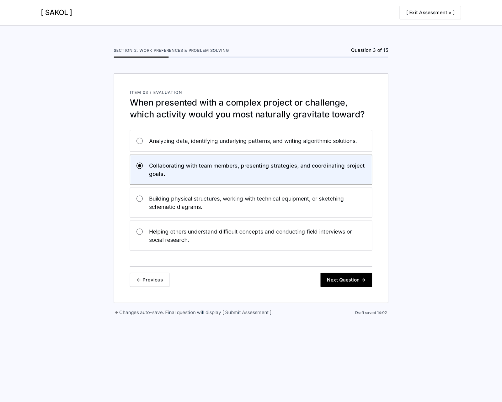

# project_Sakol
University Exploration and Major Guidance Web Application

# Sakol – University and Major Guidance Platform

Sakol is a web application designed to help Cambodian students explore universities, academic majors, and scholarship opportunities. It also provides self-assessment tools to help students reflect on their interests, strengths, and personality when exploring potential majors.

## Project Documentation

- [Project Proposal](docs/proposal/Sakol_Proposal.pdf)
- [Wireframes](docs/wireframes/)
- [Component Documentation](docs/components.md)

## Main Features

- **Universities:** Browse and search university information.
- **Majors:** Explore academic majors and possible career paths.
- **Find My Major:** Complete an assessment about interests, strengths, and career preferences.
- **Personality Assessment:** Explore personality preferences through an MBTI-inspired questionnaire.
- **Recommendations:** View suggested majors based on assessment results.

## Technology Stack

| Part | Technology |
|---|---|
| Frontend | Vue 3, TypeScript |
| Routing | Vue Router |
| State Management | Pinia |
| Testing | Vitest |
| Backend (planned) | NestJS |
| Database (planned) | PostgreSQL |
| ORM (planned) | Prisma |

## Project Structure

```text
project_Sakol/
├── docs/
│   ├── proposal/
│   ├── wireframes/
│   └── components.md
├── frontend/
└── README.md
```

## Run the Frontend

1. Clone the repository.
2. Open the project folder.
3. Navigate to the frontend:

```bash
cd frontend
```

4. Install dependencies:

```bash
npm install
```

5. Start the development server:

```bash
npm run dev
```

## Project Status

The initial frontend prototype includes the Universities, Majors, and Find My Major pages using sample data. Backend integration, database implementation, user authentication, and assessment scoring are planned for later development.

## Note

Sakol provides educational guidance and information to support students' exploration. Its recommendations are suggestions, not guarantees or final decisions about a student's future.


## Wireframes

### Universities


### Majors


### Find My Major
